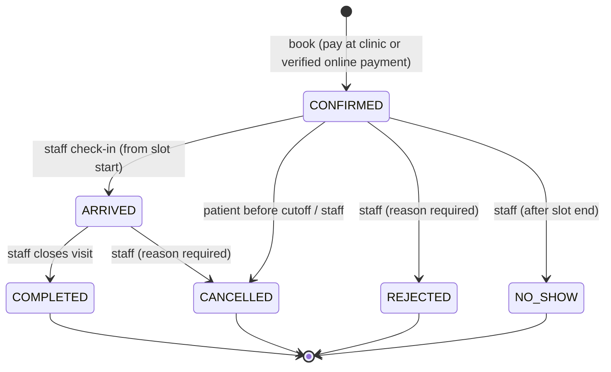
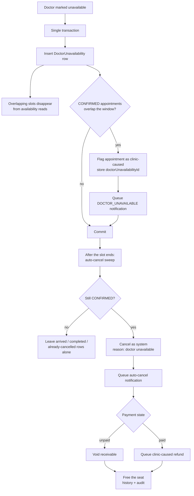
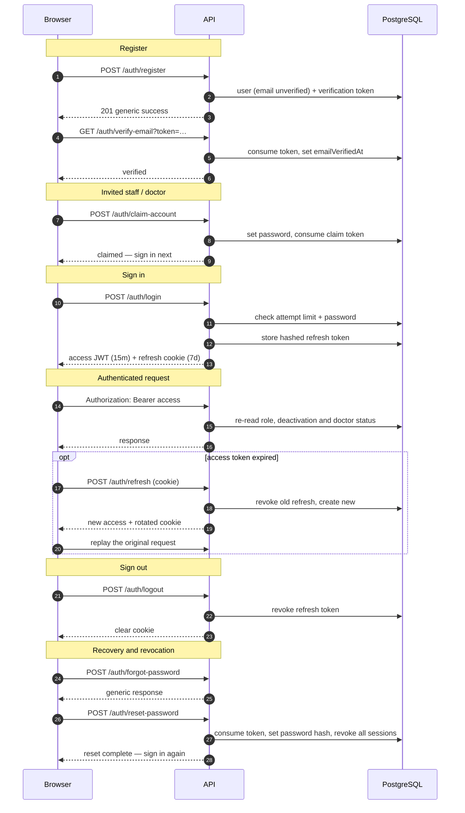

# Doctor Booking

Clinic appointment booking system. React + TypeScript client, Express + TypeScript server, PostgreSQL + Prisma.

## Run locally

Two terminals from the repo root:

```bash
npm run dev:server   # http://localhost:3000
npm run dev:client   # http://localhost:5173
```

Check the server is alive: `http://localhost:3000/api/v1/health`

## Setup

`npm install` in `client/` and `server/`.

Copy `server/.env.example` to `server/.env` and fill it in. The server validates its
environment with Zod at startup and exits with a list of every problem it found, so a
missing or malformed variable fails immediately instead of surfacing later as a null
dereference. `server/.env` is gitignored; only `.env.example` is committed.

## Database

The `postgresql://doctor_booking:...` URL in `server/.env` points at a role and
database that do not exist on a fresh machine. Create them once with:

```bash
npm run db:bootstrap
```

This reads the password out of the `DATABASE_URL` you already set, so the secret is
never written into a script and never lands in your shell history. It connects as the
`postgres` superuser and prompts for *that* password, which is a different secret the
script never touches. The underlying SQL lives in `server/prisma/bootstrap.local.sql`,
which is gitignored and psql-only.

It is idempotent — re-running is safe, and it doubles as the repair step if you ever
drop the database.

To look at the data, `npm run db:studio` opens Prisma Studio in a browser. It works from
the repo root and from `server/`. To apply schema changes to the database,
`npm run db:migrate`.

The database starts out nearly empty — Day 3 only creates a throwaway `Placeholder`
table. The real tables arrive with the Day 4 schema.

## Appointment lifecycle

An appointment is born `CONFIRMED` and moves through a small, explicit state
machine. Every interactive change goes through `appointmentTransition.service.ts`,
which checks the transition matrix, actor role, the clock, the cancellation cutoff
and any open receivable before writing history and audit rows.



- `ARRIVED` opens at the slot's start; `NO_SHOW` is allowed only after its end.
- Patients may cancel only before the cutoff. The cutoff is waived for a
  clinic-caused appointment; staff are not bound by it.
- A visit cannot be closed while a pay-at-clinic payment is still `PENDING`.
- Rescheduling is not a status change: the appointment stays `CONFIRMED` and moves
  to the new slot.
- The doctor-unavailability sweep is the one system-only path into `CANCELLED`;
  it bypasses the interactive matrix and records `actorName = "system"`.

## Doctor unavailability cascade

Marking a doctor unavailable does not delete slots. It writes one
`DoctorUnavailability` row; the availability read model hides overlapping slots,
and existing `CONFIRMED` appointments in that window are flagged for a
clinic-caused cancellation.



- The cascade flags appointments; it does not cancel them immediately. The
  auto-cancel runs once the slot has ended, and only for rows still `CONFIRMED`.
- `doctorUnavailabilityId` is the durable "clinic caused this" marker. It waives
  the patient cancellation cutoff and selects the `CLINIC_CAUSED` refund policy.
  When disruptions overlap, the first marker wins.
- A window that any appointment references cannot be deleted; removing an unused
  window simply reopens its slots.
- The sweep body is implemented today. Interval scheduling lands with the Phase 7
  jobs.

## Auth and sessions

Access is a short-lived JWT (15 minutes by default) held in memory. Renewal uses an
opaque refresh token in an `httpOnly` cookie, stored server-side only as a SHA-256
hash for seven days. Refresh tokens rotate on every use; the old token is revoked
in the same transaction.



- Login returns one error for an unknown email and a wrong password, and applies
  database-backed attempt limits before the password comparison.
- Email verification gates booking, not login. An unverified patient can still
  sign in and reach the verification flow.
- Password reset revokes every refresh token. Deactivation, suspension and
  archiving do the same. `requireAuth` also re-reads status and role on every
  request, so an access token already held by the client stops working
  immediately rather than at its 15-minute expiry.
- Claiming an invitation sets the first password and marks the email verified. It
  does not create a session; the user signs in normally afterward.
- Development builds log verification, invitation and reset links to the server
  log. Transactional email is a Phase 7 job.

## Payments

Days 23–26 cover both money paths, and the payment phase is complete on the server:

- **Pay online** — Razorpay hosted checkout. A short `SeatHold` reserves the seat
  before any money moves; a valid signature converts the hold into exactly one
  `CONFIRMED` appointment.
- **Pay at clinic** — booking creates a `PENDING` `Payment` receivable. The desk
  records cash/card/UPI later, or voids it if nothing is owed.
- **Refunds** — online money goes back through Razorpay; offline money is handed
  back as cash or UPI from the desk queue.

Both paths use the same `Payment` and `Refund` rows, and every money movement writes
an audit row. Online payments need `RAZORPAY_KEY_ID`, `RAZORPAY_KEY_SECRET` and
`RAZORPAY_WEBHOOK_SECRET`; without them those routes answer `503` and pay-at-clinic
still works.

### At a glance


An unpaid pay-at-clinic booking is simply voided when it is cancelled — no refund is
created.

### Detailed flow


Key rules:

- A `PENDING` payment is a receivable, not income. Cancelling, rejecting or
  auto-cancelling an unpaid booking voids it; only a `PAID` payment can create a
  refund.
- The desk never calls a gateway. Collection and cancellation lock the appointment
  row, so either collection wins (later cancellation queues a hand-back) or
  cancellation wins (collection refuses).
- Offline refunds keep their policy kind (`CANCELLATION`, `RESCHEDULE_DELTA`,
  `CLINIC_CAUSED`, …). "Offline" is identified by `Payment.paymentId IS NULL`, not
  by a special refund kind.
- A hand-back pays the exact queued refund amount; there is no partial payout. An
  admin retry exists only for a `FAILED` online refund.
- Offline reschedules use the actual collected amount (minus refunds already owed),
  not the booking-time fee snapshot. A `COMPLETED`/`NO_SHOW` transition is refused
  while a receivable is still `PENDING`.

Code map: `paymentOrder.service.ts` (hold + order), `paymentConvert.service.ts`
(verify/webhook conversion), `offlinePayment.service.ts` (desk collect/void) and
`refund.service.ts` (worker, hand-backs, retry) under `server/src/services/`.

## Checks

Run both before every commit:

```bash
npm run lint
npm run typecheck
```


## Docs

- `plan.md` — full specification
- `code-plan.md` — day-by-day build order
- `loopholes.md` — known gaps in the spec
