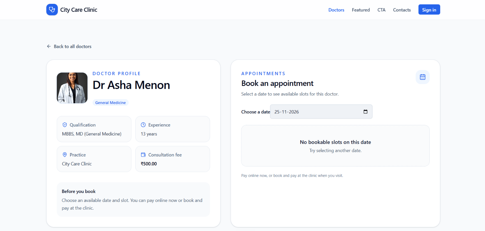
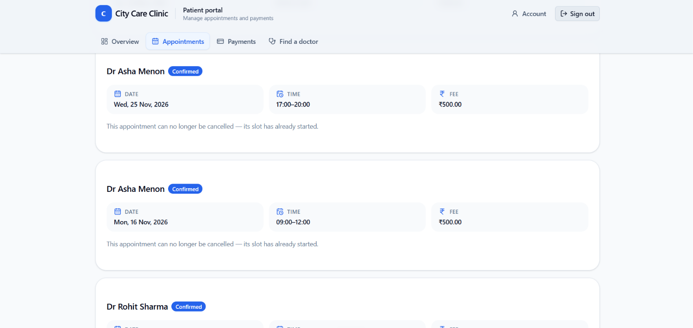
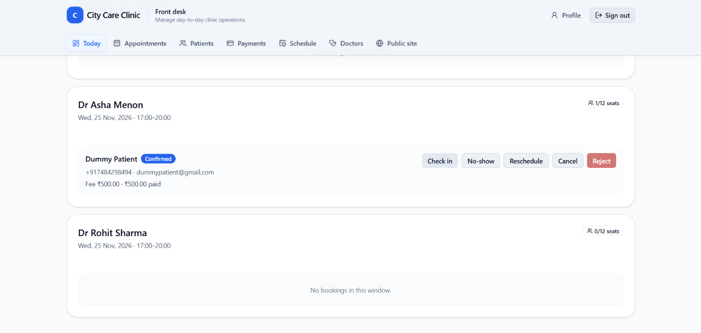
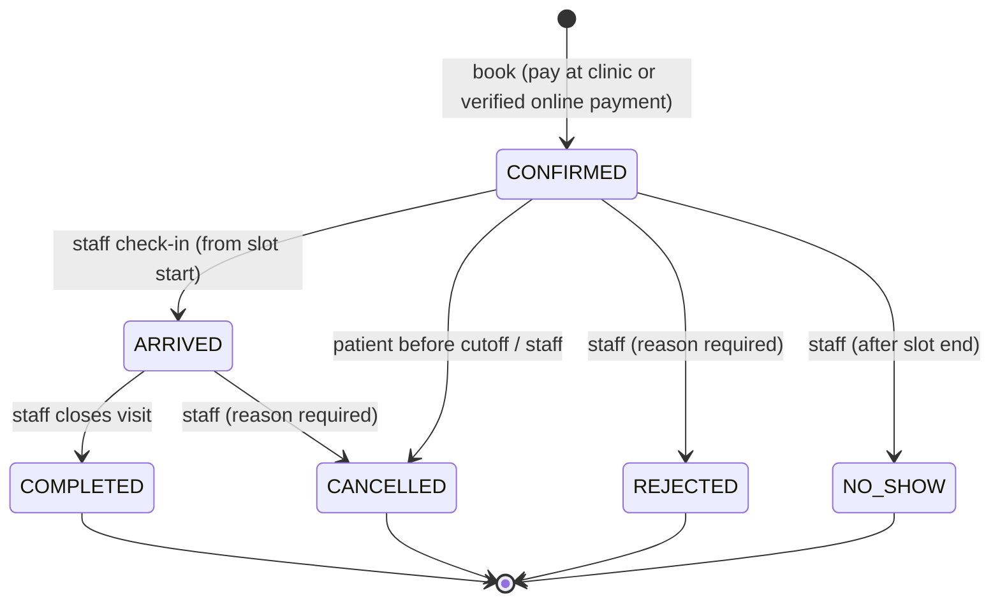
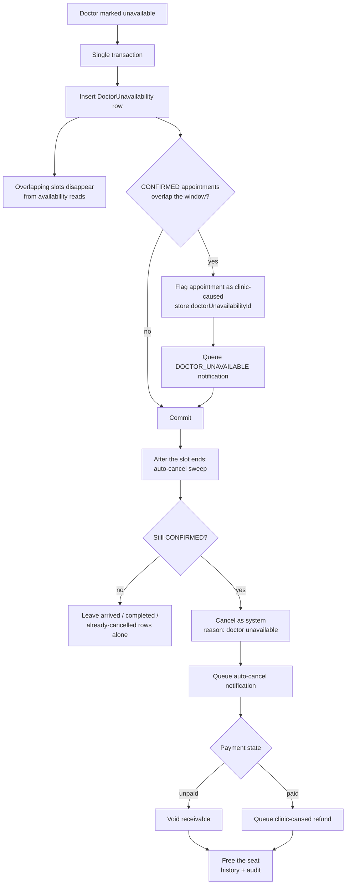
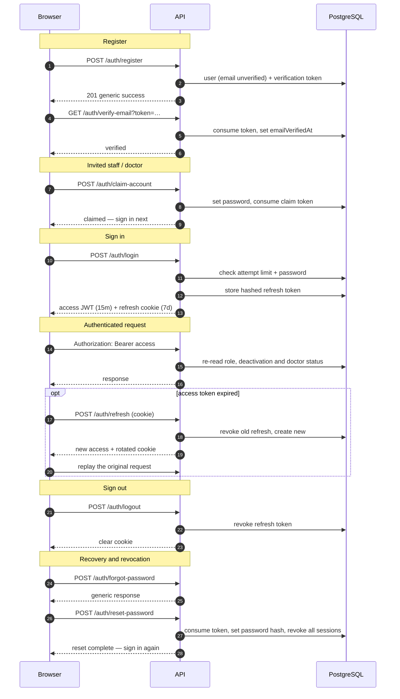
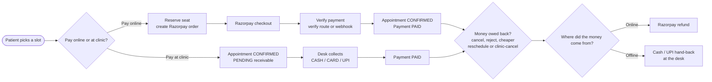
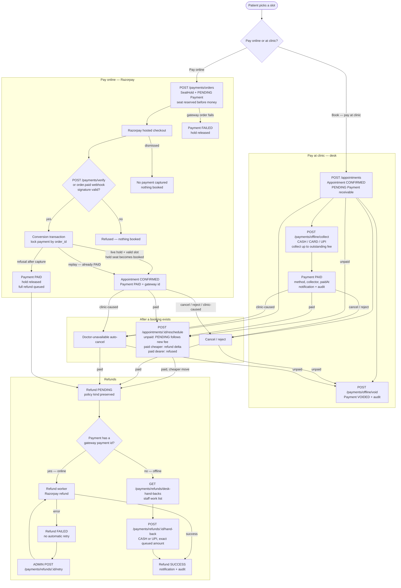
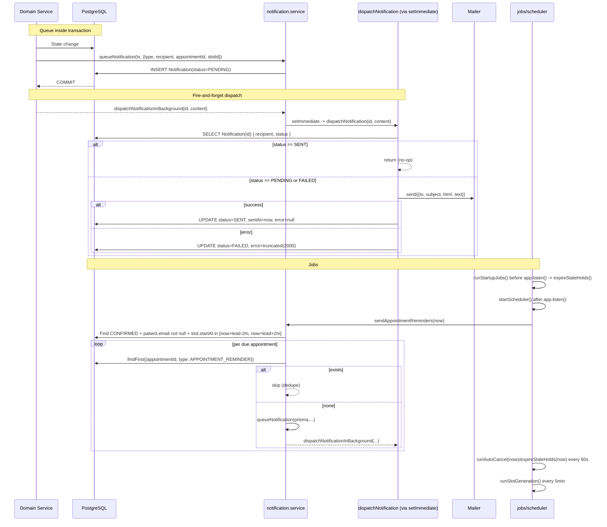

# City Care Clinic

Clinic appointment booking system. React + TypeScript client, Express + TypeScript server, PostgreSQL + Prisma.

City Care Clinic is a full-stack appointment booking platform for a multi-doctor clinic. Patients can browse doctors and specializations, see live availability, reserve a slot, and pay online with Razorpay or at the reception desk. Appointments can be rescheduled or cancelled under explicit rules, with email confirmations and reminders around every visit.

Each role gets a focused workspace: patients manage their bookings and profile, the front desk handles check-ins and pay-at-clinic collections, doctors see their upcoming queue and schedule, and admins manage doctors, schedules, clinic settings, payments and the audit trail. Role-based access, rotating sessions, transactional booking rules and a durable history keep that workflow consistent even when several staff members act at the same time.

**Live demo**

- Client (web app): `https://<client-deployed-url>`
- Server (API): `https://<server-deployed-url>`

## Tech stack

**Client**

[](https://react.dev/)
[](https://www.typescriptlang.org/)
[](https://vite.dev/)
[](https://tailwindcss.com/)
[](https://tanstack.com/query)
[](https://reactrouter.com/)
[](https://www.radix-ui.com/)
[](https://react-hook-form.com/)
[](https://zod.dev/)

**Server and data**

[](https://nodejs.org/)
[](https://expressjs.com/)
[](https://www.prisma.io/)
[](https://www.postgresql.org/)
[](https://razorpay.com/)
[](https://resend.com/)

**Tooling**

[](https://vitest.dev/)
[](https://eslint.org/)

TypeScript and Zod are shared by both apps, so form shapes and API contracts stay in sync from the browser to the database boundary.

## Screenshots

> Drop the capture files into `docs/screenshots/` with the filenames below (or repoint these paths to hosted images) to complete this section.

| Public landing page | Doctor profile and slot booking |
| --- | --- |
|  |  |

| Patient appointments | Front-desk workspace |
| --- | --- |
|  |  |

## Project structure

```text
doctor-booking/
├── client/                       # Vite + React single-page app
│   ├── public/
│   └── src/
│       ├── components/           # Shared UI, auth, payment and staff widgets
│       │   ├── auth/
│       │   ├── payments/
│       │   ├── staff/
│       │   └── ui/               # Reusable primitives (button, card, dialog, ...)
│       ├── hooks/                # Session and other client-side hooks
│       ├── layouts/              # Public, Patient, Staff, Doctor and Admin shells
│       ├── lib/                  # API client, money/date and formatting helpers
│       └── pages/                # Route screens, grouped by role
│           ├── admin/
│           ├── doctor/
│           ├── patient/
│           └── staff/
├── server/                       # Express REST API
│   ├── prisma/
│   │   ├── migrations/           # Versioned schema history
│   │   └── seed.ts               # Clinic defaults and initial accounts
│   ├── scripts/                  # Bootstrap, seeds, dev helpers, DB assertions
│   ├── src/
│   │   ├── jobs/                 # Reminders, auto-cancel, hold expiry, slot generation
│   │   ├── lib/                  # Cross-cutting helpers (auth, fees, guards, mailer, ...)
│   │   ├── middleware/           # Auth, RBAC, rate limit, request id, errors
│   │   ├── routes/               # HTTP layer: parse, authorize, shape responses
│   │   ├── schemas/              # Zod request/response contracts per route group
│   │   ├── services/             # Business rules and transactions, by domain
│   │   └── types/                # Shared TypeScript types
│   └── tests/                    # Unit and integration suites
└── README.md
```

Why this layout:

- **Two deployable apps, one repo.** `client/` and `server/` each own a `package.json`, so the SPA can ship to static hosting while the API is deployed separately. The root only proxies the shared dev, lint and typecheck commands.
- **Client: pages → layouts → components.** Pages own route-level data and actions, layouts own role navigation and chrome, and `components/ui` holds small reusable primitives. Role folders keep patient, staff, doctor and admin screens from bleeding into one another.
- **Server: thin routes, domain services.** Routes parse input with Zod, enforce auth/RBAC and shape responses; services own transactions, state transitions, booking guards and payment/refund policies. HTTP concerns stay out of the rules, which both routes and background jobs can reuse.
- **Schemas next to routes.** One Zod file per route group keeps validation, and the types derived from it, beside the endpoint that uses them.
- **Jobs are first-class.** Reminders, auto-cancel and hold expiry live in `src/jobs/` instead of being hidden in routes, and call the same services the API does.
- **Database changes are versioned.** Schema history lives in `prisma/migrations`, seed data is reproducible, `db:assert` checks hand-written constraints, and one-off tooling stays in `scripts/` rather than runtime code.

## Run locally

Two terminals from the repo root:

```bash
npm run dev:server   # http://localhost:3000
npm run dev:client   # http://localhost:5173
```

Check the server is alive: `http://localhost:3000/api/v1/health`

## Setup

`npm install` in `client/` and `server/`.

Copy `server/.env.example` to `server/.env` and fill it in. The server validates its
environment with Zod at startup and exits with a list of every problem it found, so a
missing or malformed variable fails immediately instead of surfacing later as a null
dereference. `server/.env` is gitignored; only `.env.example` is committed.

## Database

The `postgresql://doctor_booking:...` URL in `server/.env` points at a role and
database that do not exist on a fresh machine. Create them once with:

```bash
npm run db:bootstrap
```

This reads the password out of the `DATABASE_URL` you already set, so the secret is
never written into a script and never lands in your shell history. It connects as the
`postgres` superuser and prompts for *that* password, which is a different secret the
script never touches. The underlying SQL lives in `server/prisma/bootstrap.local.sql`,
which is gitignored and psql-only.

It is idempotent — re-running is safe, and it doubles as the repair step if you ever
drop the database.

To look at the data, `npm run db:studio` opens Prisma Studio in a browser. It works from
the repo root and from `server/`. To apply schema changes to the database,
`npm run db:migrate`.

From `server/`, `npm run db:seed` loads the clinic defaults and initial accounts described
in `server/prisma/seed.ts`. `npm run db:reset` is destructive: it re-runs every migration
and re-seeds. `npm run db:assert` checks the hand-written DB constraints and enum
discipline against the current database.

The full schema now arrives through Prisma migrations; the old Day 3 placeholder table is
long gone.

## Appointment lifecycle

An appointment is born `CONFIRMED` and moves through a small, explicit state
machine. Every interactive change goes through `appointmentTransition.service.ts`,
which checks the transition matrix, actor role, the clock, the cancellation cutoff
and any open receivable before writing history and audit rows.



- `ARRIVED` opens at the slot's start; `NO_SHOW` is allowed only after its end.
- Patients may cancel only before the cutoff. The cutoff is waived for a
  clinic-caused appointment; staff are not bound by it.
- A visit cannot be closed while a pay-at-clinic payment is still `PENDING`.
- Rescheduling is not a status change: the appointment stays `CONFIRMED` and moves
  to the new slot.
- The doctor-unavailability sweep is the one system-only path into `CANCELLED`;
  it bypasses the interactive matrix and records `actorName = "system"`.

## Doctor unavailability cascade

Marking a doctor unavailable does not delete slots. It writes one
`DoctorUnavailability` row; the availability read model hides overlapping slots,
and existing `CONFIRMED` appointments in that window are flagged for a
clinic-caused cancellation.



- The cascade flags appointments; it does not cancel them immediately. The
  auto-cancel runs once the slot has ended, and only for rows still `CONFIRMED`.
- `doctorUnavailabilityId` is the durable "clinic caused this" marker. It waives
  the patient cancellation cutoff and selects the `CLINIC_CAUSED` refund policy.
  When disruptions overlap, the first marker wins.
- A window that any appointment references cannot be deleted; removing an unused
  window simply reopens its slots.
- The sweep body is implemented today. Interval scheduling lands with the Phase 7
  jobs.

## Auth and sessions

Access is a short-lived JWT (15 minutes by default) held in memory. Renewal uses an
opaque refresh token in an `httpOnly` cookie, stored server-side only as a SHA-256
hash for seven days. Refresh tokens rotate on every use; the old token is revoked
in the same transaction.



- Login returns one error for an unknown email and a wrong password, and applies
  database-backed attempt limits before the password comparison.
- Email verification gates booking, not login. An unverified patient can still
  sign in and reach the verification flow.
- Password reset revokes every refresh token. Deactivation, suspension and
  archiving do the same. `requireAuth` also re-reads status and role on every
  request, so an access token already held by the client stops working
  immediately rather than at its 15-minute expiry.
- Claiming an invitation sets the first password and marks the email verified. It
  does not create a session; the user signs in normally afterward.
- Development builds log verification, invitation and reset links to the server
  log. Production uses Resend and refuses to boot without `RESEND_API_KEY`; see
  `server/.env.example` for `EMAIL_FROM`, `EMAIL_FROM_NAME` and `EMAIL_REPLY_TO`.
  A Resend sandbox sender can only deliver to the address on the Resend account,
  so real patients need a verified domain.

## Payments

Days 23–26 cover both money paths, and the payment phase is complete on the server:

- **Pay online** — Razorpay hosted checkout. A short `SeatHold` reserves the seat
  before any money moves; a valid signature converts the hold into exactly one
  `CONFIRMED` appointment.
- **Pay at clinic** — booking creates a `PENDING` `Payment` receivable. The desk
  records cash/card/UPI later, or voids it if nothing is owed.
- **Refunds** — online money goes back through Razorpay; offline money is handed
  back as cash or UPI from the desk queue.

Both paths use the same `Payment` and `Refund` rows, and every money movement writes
an audit row. Online payments need `RAZORPAY_KEY_ID`, `RAZORPAY_KEY_SECRET` and
`RAZORPAY_WEBHOOK_SECRET`; without them those routes answer `503` and pay-at-clinic
still works.

### At a glance



An unpaid pay-at-clinic booking is simply voided when it is cancelled — no refund is
created.

### Detailed flow



Key rules:

- A `PENDING` payment is a receivable, not income. Cancelling, rejecting or
  auto-cancelling an unpaid booking voids it; only a `PAID` payment can create a
  refund.
- The desk never calls a gateway. Collection and cancellation lock the appointment
  row, so either collection wins (later cancellation queues a hand-back) or
  cancellation wins (collection refuses).
- Offline refunds keep their policy kind (`CANCELLATION`, `RESCHEDULE_DELTA`,
  `CLINIC_CAUSED`, …). "Offline" is identified by `Payment.paymentId IS NULL`, not
  by a special refund kind.
- A hand-back pays the exact queued refund amount; there is no partial payout. An
  admin retry exists only for a `FAILED` online refund.
- Offline reschedules use the actual collected amount (minus refunds already owed),
  not the booking-time fee snapshot. A `COMPLETED`/`NO_SHOW` transition is refused
  while a receivable is still `PENDING`.

Code map: `paymentOrder.service.ts` (hold + order), `paymentConvert.service.ts`
(verify/webhook conversion), `offlinePayment.service.ts` (desk collect/void) and
`refund.service.ts` (worker, hand-backs, retry) under `server/src/services/`.

## Notifications & Jobs

- **Queue in-transaction**: `queueNotification(client, input)` writes a `PENDING` `Notification` inside the caller's transaction so intent commits with the state change.
- **Dispatch post-commit**: `dispatchNotification(notificationId, content)` reads the row and calls the mailer. `dispatchNotificationInBackground()` uses `setImmediate()` for fire-and-forget delivery (never blocks HTTP/jobs).
- **Templates**: All appointment/payment emails live in `server/src/lib/emailTemplates.ts` (`appointmentBookedEmail`, `appointmentCancelledEmail`, `appointmentRescheduledEmail`, `appointmentRejectedEmail`, `doctorUnavailableEmail`, `appointmentAutoCancelledEmail`, `paymentReceiptEmail`, `refundCompletedEmail`, `appointmentReminderEmail`).
- **Scheduler**: `server/src/jobs/scheduler.ts` runs `runStartupJobs()` before `app.listen()` (hold-expiry sweep), then `startScheduler()` sets intervals (reminders/auto-cancel/hold-expiry every 60s, slot generation every 5min). No Redis/queue.
- **Jobs**: `sendAppointmentReminders()` dedupes by existing `APPOINTMENT_REMINDER` row and only emails `CONFIRMED` appointments with patient emails in `now + reminderLeadMinutes ± 2min`. `expireStaleHolds()` releases expired holds, decrements `heldCount` safely, best-effort voids tied `PENDING` payments. `runAutoCancel()` calls `autoCancelAfterSlotEnd()`. `runSlotGeneration()` calls `materializeSlots()`.

### Quick Overview

```mermaid
flowchart TD
  A["Domain Events\n(Booking / Cancel / Reject / Convert / Refund)"] --> B["queueNotification(tx, ...)\nINSERT Notification(PENDING)"]
  B --> C["DB Transaction Commit"]
  C --> D["dispatchNotificationInBackground(id, content)\nsetImmediate → dispatchNotification(id, content)"]
  D --> E{"Exists & status != SENT"}
  E -- "No" --> F["Skip"]
  E -- "Yes" --> G["Call Mailer"]
  G -- "Success" --> H["status = SENT\nsentAt = now"]
  G -- "Failure" --> I["status = FAILED\nerror = truncated(2000)"]

  J["server.ts"] --> K["runStartupJobs() before app.listen()\n→ expireStaleHolds()"]
  K --> L["app.listen()"]
  L --> M["startScheduler() after listen()"]
  M --> N["Intervals: 60s (reminders / auto-cancel / hold-expiry)\n5 min (slot generation)"]
  N --> O["sendAppointmentReminders(now)\n(Dedupe by APPOINTMENT_REMINDER, T+lead ± 2m)"]
  N --> P["runAutoCancel(now) → autoCancelAfterSlotEnd(now)"]
  N --> Q["expireStaleHolds(now)"]
  N --> R["runSlotGeneration() → materializeSlots()"]
  O --> B

    classDef hold fill:transparent,stroke:#9ca3af,stroke-width:1px,color:#fff
    classDef queue fill:transparent,stroke:#9ca3af,stroke-width:1px,color:#fff
    classDef pay fill:transparent,stroke:#9ca3af,stroke-width:1px,color:#fff
    classDef book fill:transparent,stroke:#9ca3af,stroke-width:1px,color:#fff
    classDef resched fill:transparent,stroke:#9ca3af,stroke-width:1px,color:#fff
    classDef refund fill:transparent,stroke:#9ca3af,stroke-width:1px,color:#fff
    classDef auto fill:transparent,stroke:#9ca3af,stroke-width:1px,color:#fff
    classDef late fill:transparent,stroke:#9ca3af,stroke-width:1px,color:#fff
    class A,B,C,D,E,F,G,H,I,J,K,L,M,N,O,P,Q,R book
```

### Detailed Code Flow



## Checks

From the repo root, `npm run lint` and `npm run typecheck` cover both client and server.
From `server/`, also run:

```bash
npm run typecheck:tests
npm test
npm run db:assert
```

The database-backed suite is destructive to its own isolated database. From `server/`,
unset any inherited `DATABASE_URL`/`TEST_DATABASE_URL`, confirm `TEST_DATABASE_URL` ends
in `_test`, then run `npm run test:integration`. It resets and re-migrates that test
database before running Vitest; never point it at data you want to keep.

## Operations

### Backups

Use PostgreSQL's custom format so a restore can be selective:

```bash
pg_dump --format=custom --file=doctor_booking.backup "$DATABASE_URL"
pg_restore --clean --if-exists --dbname="$DATABASE_URL" doctor_booking.backup
```

Run these from `server/` with `DATABASE_URL` loaded from `.env`. Restoring over a live
database destroys current data; take a fresh dump first.

### Logging and security middleware

Pino logs one line per request with a sanitized URL; credential query parameters and
headers are redacted. A client-supplied `x-request-id` is validated and echoed in the
header and every error body, or generated when absent. The server disables
`x-powered-by`, trusts one proxy hop for rate-limit IPs, restricts CORS to `CLIENT_URL`,
caps JSON bodies at 1 MB, re-reads account status on every authenticated request, and
verifies the Razorpay webhook HMAC over raw bytes before conversion.


## Docs

- `plan.md` — full specification
- `code-plan.md` — day-by-day build order
- `loopholes.md` — known gaps in the spec
