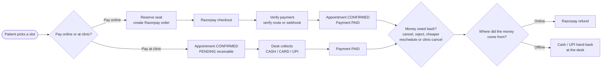
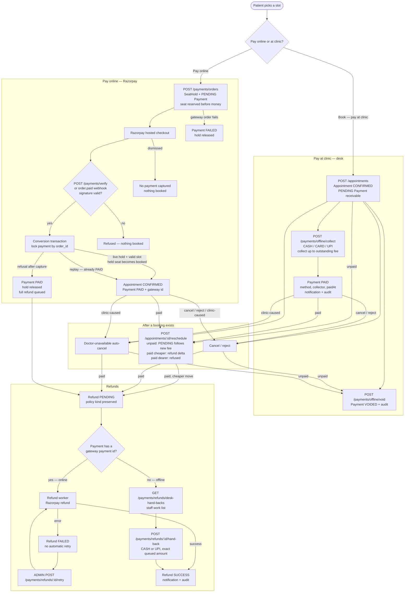

# Doctor Booking

Clinic appointment booking system. React + TypeScript client, Express + TypeScript server, PostgreSQL + Prisma.

## Run locally

Two terminals from the repo root:

```bash
npm run dev:server   # http://localhost:3000
npm run dev:client   # http://localhost:5173
```

Check the server is alive: `http://localhost:3000/api/v1/health`

## Setup

`npm install` in `client/` and `server/`.

Copy `server/.env.example` to `server/.env` and fill it in. The server validates its
environment with Zod at startup and exits with a list of every problem it found, so a
missing or malformed variable fails immediately instead of surfacing later as a null
dereference. `server/.env` is gitignored; only `.env.example` is committed.

## Database

The `postgresql://doctor_booking:...` URL in `server/.env` points at a role and
database that do not exist on a fresh machine. Create them once with:

```bash
npm run db:bootstrap
```

This reads the password out of the `DATABASE_URL` you already set, so the secret is
never written into a script and never lands in your shell history. It connects as the
`postgres` superuser and prompts for *that* password, which is a different secret the
script never touches. The underlying SQL lives in `server/prisma/bootstrap.local.sql`,
which is gitignored and psql-only.

It is idempotent — re-running is safe, and it doubles as the repair step if you ever
drop the database.

To look at the data, `npm run db:studio` opens Prisma Studio in a browser. It works from
the repo root and from `server/`. To apply schema changes to the database,
`npm run db:migrate`.

The database starts out nearly empty — Day 3 only creates a throwaway `Placeholder`
table. The real tables arrive with the Day 4 schema.

## Payments

Days 23–26 cover both money paths, and the payment phase is complete on the server:

- **Pay online** — Razorpay hosted checkout. A short `SeatHold` reserves the seat
  before any money moves; a valid signature converts the hold into exactly one
  `CONFIRMED` appointment.
- **Pay at clinic** — booking creates a `PENDING` `Payment` receivable. The desk
  records cash/card/UPI later, or voids it if nothing is owed.
- **Refunds** — online money goes back through Razorpay; offline money is handed
  back as cash or UPI from the desk queue.

Both paths use the same `Payment` and `Refund` rows, and every money movement writes
an audit row. Online payments need `RAZORPAY_KEY_ID`, `RAZORPAY_KEY_SECRET` and
`RAZORPAY_WEBHOOK_SECRET`; without them those routes answer `503` and pay-at-clinic
still works.

### At a glance



An unpaid pay-at-clinic booking is simply voided when it is cancelled — no refund is
created.

### Detailed flow



Key rules:

- A `PENDING` payment is a receivable, not income. Cancelling, rejecting or
  auto-cancelling an unpaid booking voids it; only a `PAID` payment can create a
  refund.
- The desk never calls a gateway. Collection and cancellation lock the appointment
  row, so either collection wins (later cancellation queues a hand-back) or
  cancellation wins (collection refuses).
- Offline refunds keep their policy kind (`CANCELLATION`, `RESCHEDULE_DELTA`,
  `CLINIC_CAUSED`, …). "Offline" is identified by `Payment.paymentId IS NULL`, not
  by a special refund kind.
- A hand-back pays the exact queued refund amount; there is no partial payout. An
  admin retry exists only for a `FAILED` online refund.
- Offline reschedules use the actual collected amount (minus refunds already owed),
  not the booking-time fee snapshot. A `COMPLETED`/`NO_SHOW` transition is refused
  while a receivable is still `PENDING`.

Code map: `paymentOrder.service.ts` (hold + order), `paymentConvert.service.ts`
(verify/webhook conversion), `offlinePayment.service.ts` (desk collect/void) and
`refund.service.ts` (worker, hand-backs, retry) under `server/src/services/`.

## Checks

Run both before every commit:

```bash
npm run lint
npm run typecheck
```


## Docs

- `plan.md` — full specification
- `code-plan.md` — day-by-day build order
- `loopholes.md` — known gaps in the spec
